# EasyNetBak (网络设备备份系统)

## 🔗 项目仓库

两个仓库内容保持同步，可任选一个访问或克隆。

  <a href="https://github.com/xiongmp/EasyNetBak">
    
    <strong> GitHub 仓库</strong>
  </a>
  &nbsp;&nbsp;
  <a href="https://gitee.com/xmp111/EasyNetBak">
    
    <strong> Gitee 仓库</strong>
  </a>

***

EasyNetBak 是一个面向网络工程师的网络设备配置备份与管理平台，集成设备资产管理、自动化备份、配置差异分析、多渠道通知（邮件/企业微信/飞书/钉钉/webhook）、WebShell 运维入口、RBAC 权限控制与审计日志，为网络管理员提供完整的配置生命周期管理能力。

> ⚠️ **安全建议**:
>
> - 为了保障网络设备安全，建议使用 **只读权限 (Read-Only)** 账号进行设备备份，最小化安全风险。
> - 建议先在测试环境测试功能，再应用到生产环境，避免直接在生产环境中使用。

## 💬 交流、支持与反馈

- **Gitee Issues**：适合提交可复现的问题、功能建议和设备兼容性反馈。提问时请提供版本、部署方式、操作步骤及脱敏后的日志，以便快速定位。
- **公众号交流**：建议优先在相关文章下的留言区交流，也可以通过公众号后台联系进微信交流群。

  

请勿在公开渠道提交设备密码、Token、私钥、完整配置、内网地址或其他敏感信息。

> **📣 社区支持**
>
> EasyNetBak 是一个开源项目，并非商业服务，项目不承诺固定的响应时间或服务等级。欢迎以友好、具体的方式交流（请勿将作者视为客服人员），也请理解维护者通常需要结合空闲时间处理问题和建议。

***

## 💖 支持项目

如果这个项目对你有帮助，欢迎通过以下方式支持：

### ⭐ Star 项目

点击右上角的 ⭐ Star 按钮，让更多人发现这个项目。

### 💰 赞赏支持

如果这个项目对你有所帮助，欢迎请作者喝杯咖啡，感谢你的支持！

<table>
  <tr>
    <th>爱发电</th>
    <th>微信赞赏码</th>
  </tr>
  <tr>
    <td align="center">
      
    </td>
    <td align="center">
      
    </td>
  </tr>
</table>

***

## ✨ 主要功能

| 模块               | 核心功能                                                                                                                        |
| :--------------- | :-------------------------------------------------------------------------------------------------------------------------- |
| **设备与资源管理**      | • **资产管理**：统一管理设备、分组、凭据及按平台配置的备份命令模板；设备支持 CSV 批量导入/导出、批量更新、批量备份与筛选 • **连通性检测**：基于 Celery 的批量异步检查，记录可达状态、耗时和错误原因 • **WebShell**：浏览器内 SSH/Telnet 实时终端，支持会话导出以及录像记录和回放 |
| **自动化备份与调度**     | • **多厂商备份**：基于 Netmiko，支持 SSH/Telnet 与多种网络平台，按设备模板执行命令采集 • **任务调度**：支持手动、批量和 Cron 定时备份；可按平台、分组或设备选择定时任务目标，并预览下次执行时间 • **任务编排**：支持失败重试、超时控制、运行状态跟踪、单项/批量终止与重试，以及备份和运行记录保留清理 |
| **配置管理与对比**      | • **版本对比**：内置 Diff 查看器，支持并排与统一视图及仅查看变更行 • **Diff 忽略规则**：支持全局、平台和分组范围的正则规则，过滤无关行并参与配置变更检测 • **配置搜索**：支持在最新配置或全部历史备份中检索关键字，并查看完整配置 |
| **可视化仪表盘**       | • 展示设备可达状态、备份数量与成功率、运行中任务及任务健康度 • 提供 24 小时/7 天/30 天备份趋势、平台分布、分组健康度、备份耗时和 S3/FTP 上传统计 • 汇总每台设备最近一次备份记录，并支持按成功/失败筛选 |
| **安全与权限 (RBAC)** | • 用户与角色分级管理，支持细粒度权限可视化配置及按设备组限制资源范围 • 支持 MFA 双因素认证、管理员恢复码和 API Key 过期/吊销管理 • **凭据加密**：设备、通知和存储等敏感凭据加密存储 |
| **审计与日志**        | • **操作审计**：记录设备、凭据、任务、权限、通知和存储等关键操作，支持搜索、筛选与 CSV 导出 • **登录日志**：记录登录成功、失败及登出行为，支持筛选与导出 • **WebShell 回放**：保存会话录像，支持按条件查询和回放 |
| **通知与存储**        | • **通知路由**：支持 SMTP 邮件、企业微信、钉钉、飞书和通用 Webhook；可按备份失败、配置变更、备份汇总、任务终止配置策略，并按设备组（含子组）、平台和失败类型筛选；支持通知模板、预览、通道测试、投递记录与失败重试 • **远端存储**：备份完成后可自动上传至 AWS S3 及兼容 S3 的对象存储（如 MinIO、阿里云 OSS、腾讯云 COS），或 FTP；S3/FTP 可独立启用，支持自定义前缀/目录和连通性测试 |
| **开放 API 与集成**    | • 提供版本化 `/api/v1/` 公共 API，覆盖设备、分组、凭据、备份模板、备份查询和系统统计 • 使用 `X-API-Key` 鉴权，并沿用细粒度权限和设备组范围控制；提供分页响应及 OpenAPI/Swagger 接口文档 |

## 🛠 技术栈

| 领域         | 技术选型                                                                                                 |
| :--------- | :--------------------------------------------------------------------------------------------------- |
| **后端**     | Python 3.10+ (Docker 镜像默认使用 Python 3.12), FastAPI, SQLModel (SQLAlchemy), Celery, APScheduler, Redis |
| **前端**     | Bootstrap 5, Jinja2 模板引擎, ECharts                                                                    |
| **网络与自动化** | Netmiko, AsyncSSH, Telnetlib3                                                                        |
| **数据库**    | PostgreSQL (生产推荐) / SQLite (开发可选)                                                                    |
| **容器化**    | Docker, Docker Compose                                                                               |

## 🚀 安装部署

<table>
  <tr>
    <td align="center">
      <h3>📖 官方安装部署文档</h3>
      
Docker 部署、传统部署（非docker部署）和升级等详细内容，均已整理在官网文档中。

      

        <a href="https://netopsbase.com/projects/easynetbak/"><strong>👉 查看 EasyNetBak 安装部署文档</strong></a>
      

    </td>
  </tr>
</table>

## 📚 界面展示

### 登录界面 (Login)

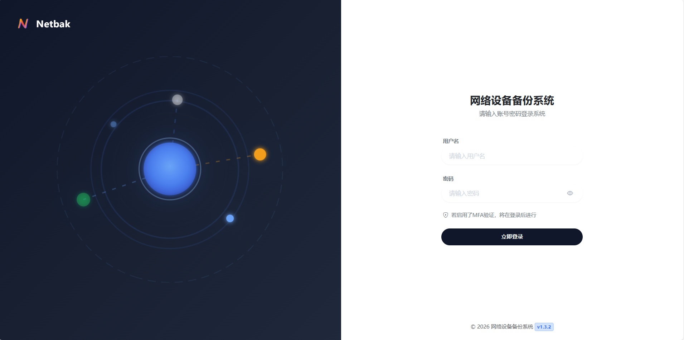

### 仪表盘 (Dashboard)

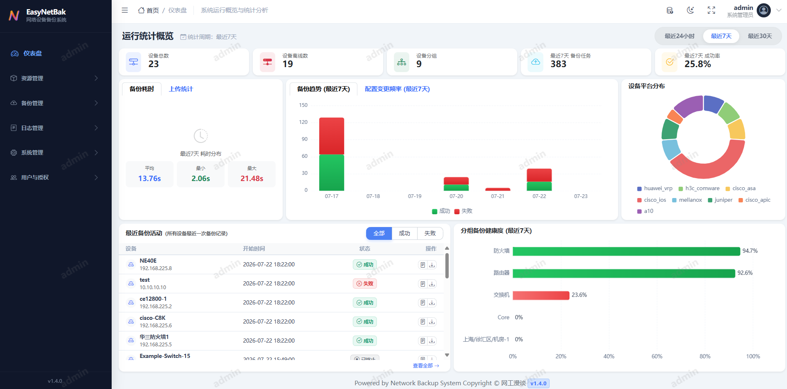

### 设备管理 (Device Management)

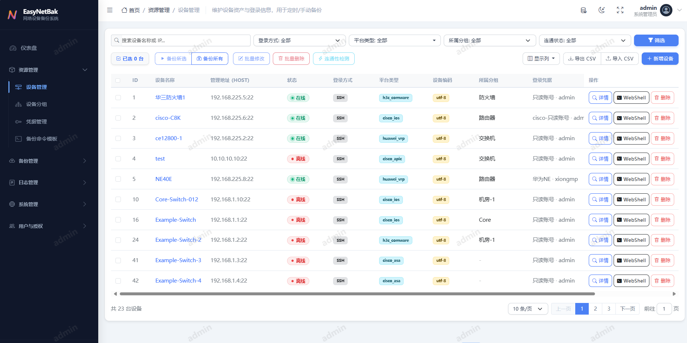

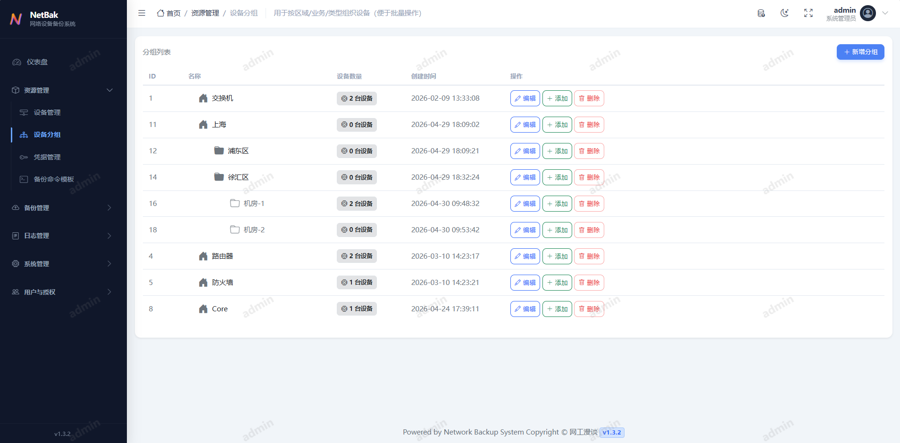

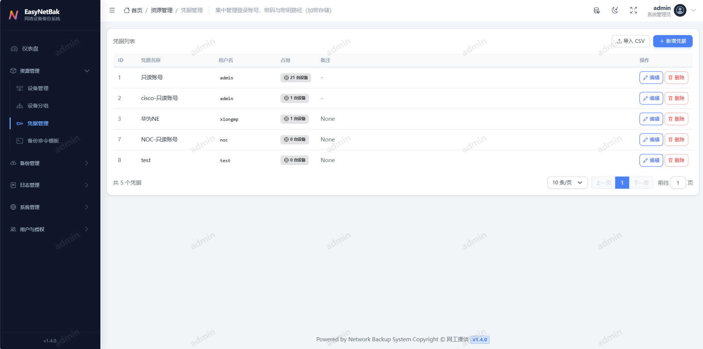

### 备份与任务 (Backups & Tasks)

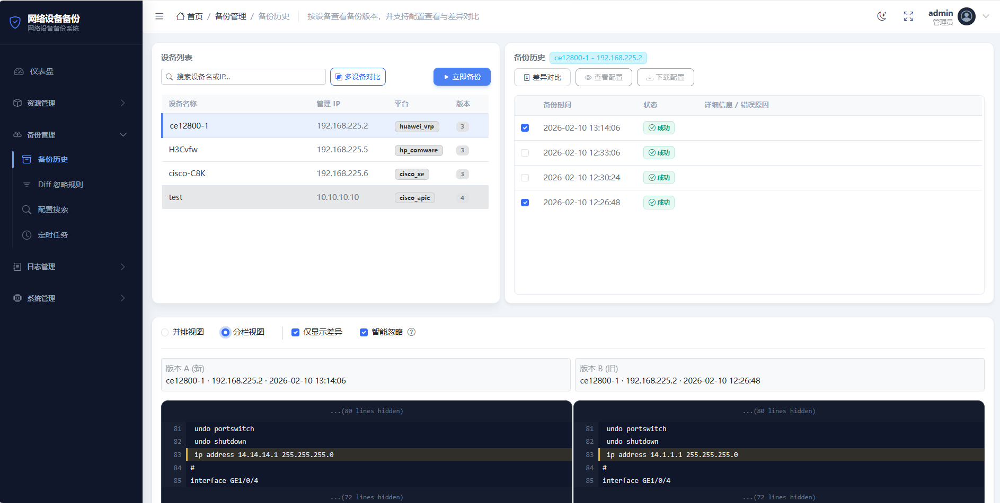

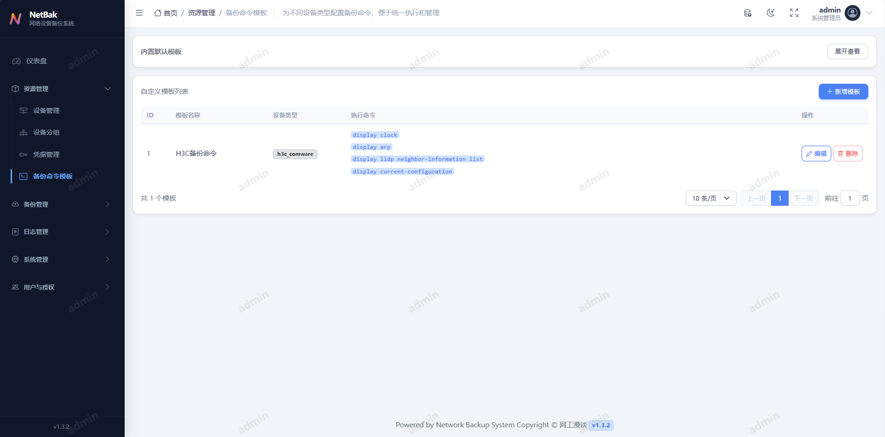

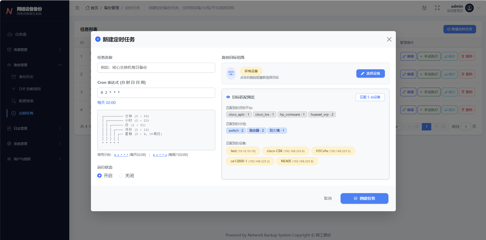

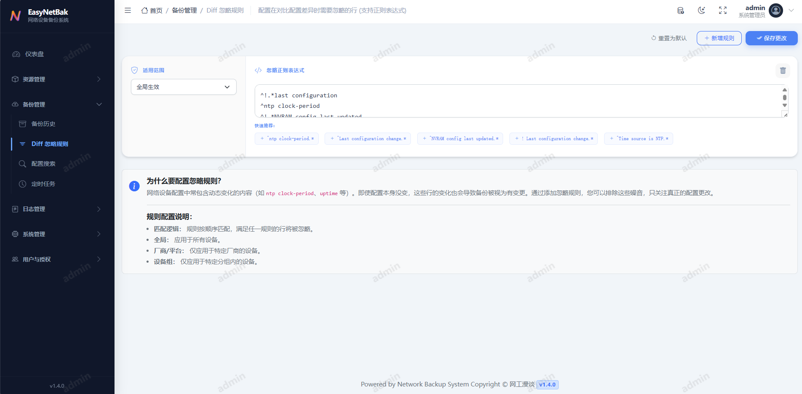

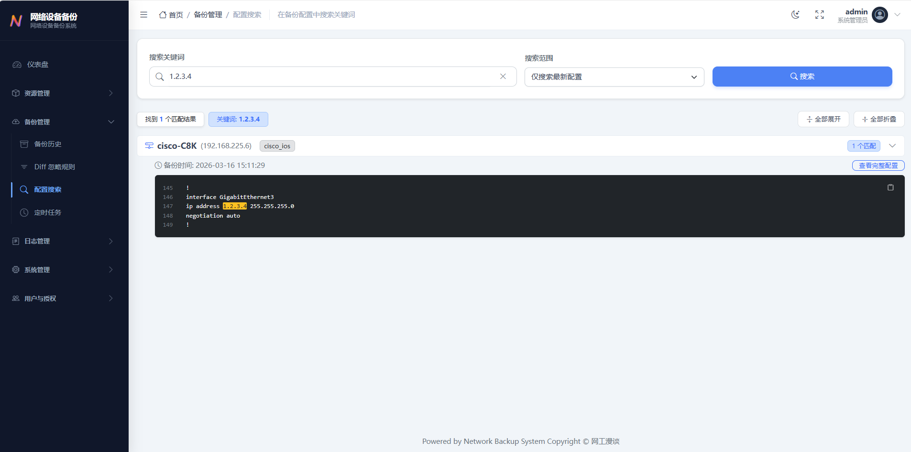

### 审计与日志 (Logs)

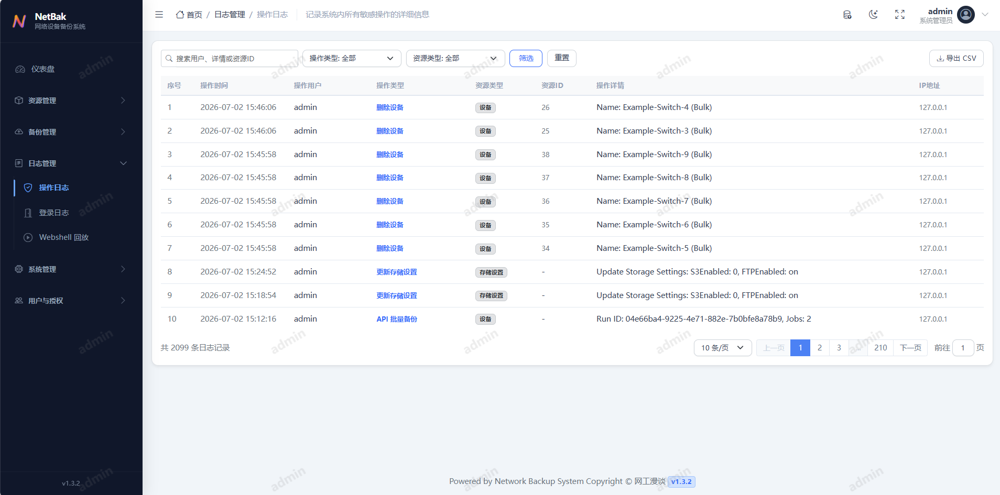

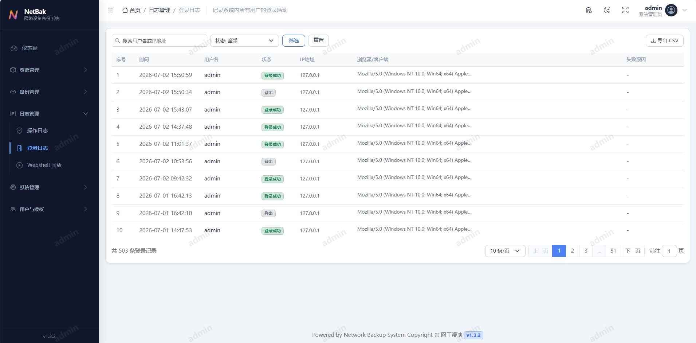

### 系统管理 (System Management)

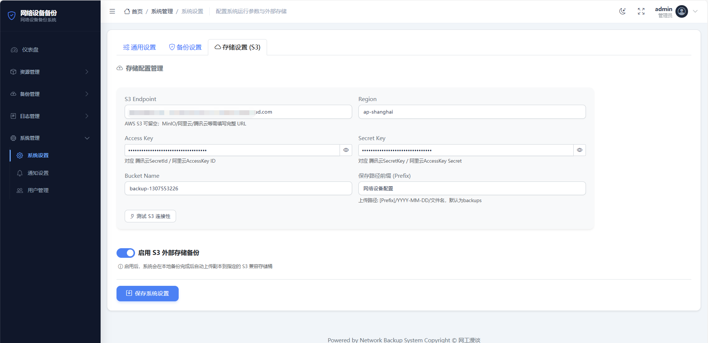

### 通知设置 (Notifications)

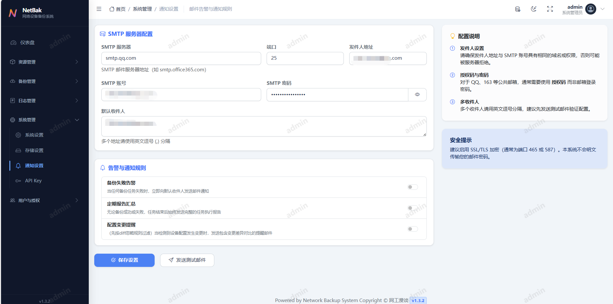

### 存储设置 (Storage Settings)

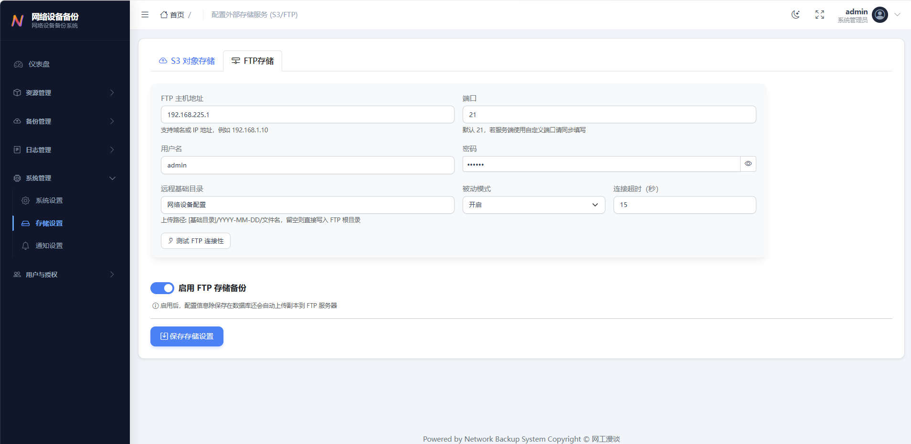

### 用户和权限 (User Management)

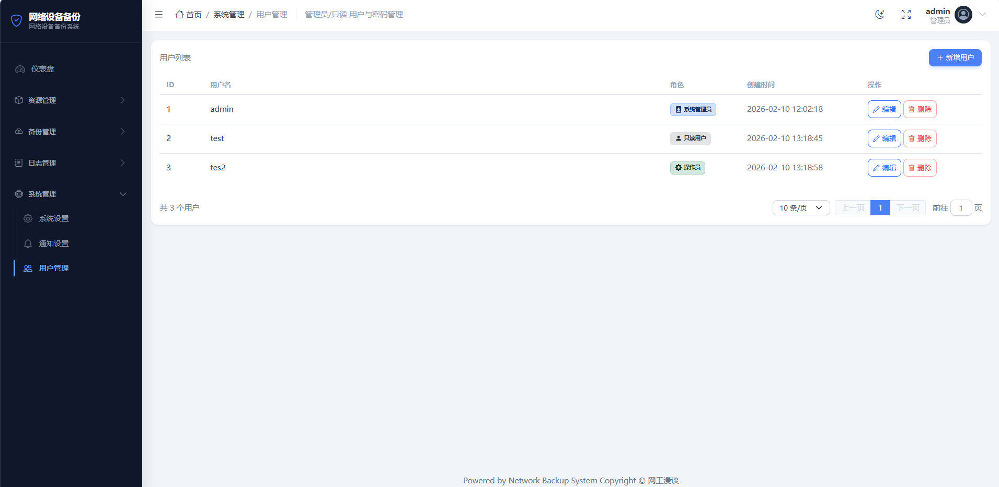
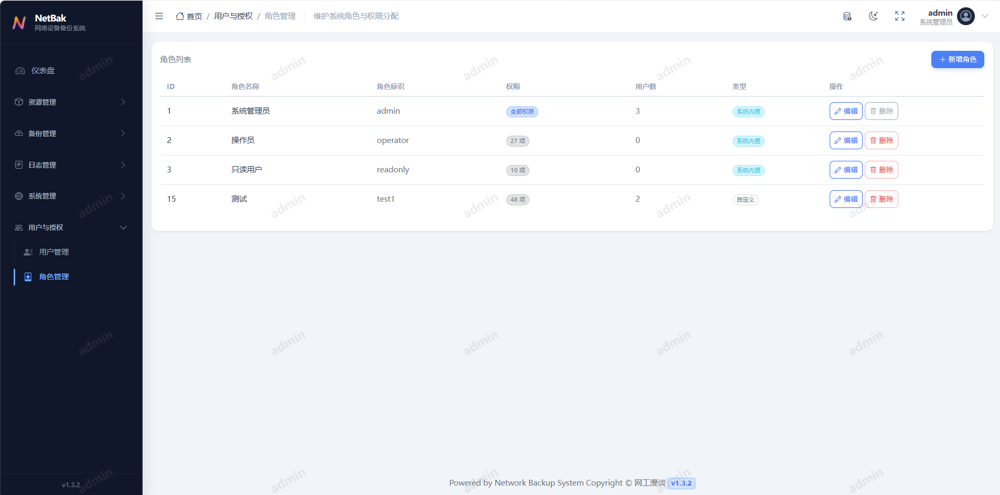

### API接口和文档

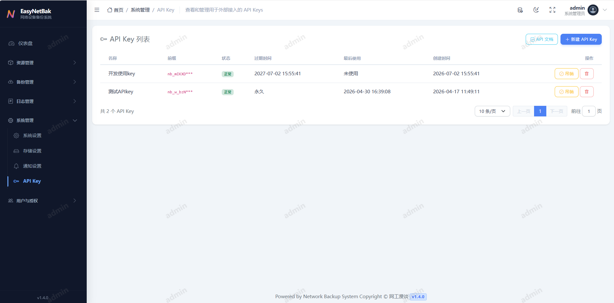

## 📄 开源许可

EasyNetBak 基于 [Apache License 2.0](LICENSE) 开源发布。

在遵守 Apache-2.0 条款的前提下，任何个人或组织均可使用、复制、修改和分发本项目，包括将其用于商业用途。

再分发本项目或其衍生版本时，请按照 Apache-2.0 的要求：

- 向接收者提供一份 Apache-2.0 许可证；
- 在修改过的文件中保留明确的修改说明；
- 保留适用的版权、专利、商标和署名声明；
- 按照 Apache-2.0 第 4 条的要求保留本项目 `NOTICE` 文件中的适用内容。

### 名称与标识

Apache-2.0 不授予 EasyNetBak 名称、Logo 或其他项目标识的商标使用权。

在说明软件来源、引用项目名称以及按 `NOTICE` 要求进行合理署名时，可以合理使用 EasyNetBak 名称；未经授权，不得使用 EasyNetBak 名称或标识暗示其产品、服务或衍生版本获得本项目官方认证、授权或背书。

## ⚠️ 安全与责任提示

EasyNetBak 及其关联代码、文档按照 Apache-2.0 许可证以“原样”提供，不提供任何明示或暗示的担保。许可证中的免责声明和责任限制以 [`LICENSE`](LICENSE) 为准。

本项目涉及网络设备配置备份、凭据管理、WebShell 终端访问、异步任务及远程存储等高风险功能。因配置错误、系统漏洞、网络波动或第三方依赖缺陷，可能造成设备断网、配置丢失、业务中断或敏感数据泄露。使用者应在部署和使用前自行评估风险，并承担相应责任。

在适用法律允许的最大范围内，项目原作者、贡献者及版权持有人不对因使用、无法使用本项目或与本项目相关行为产生的直接、间接、特殊、偶然或惩罚性损害承担责任。

使用者应：

- 妥善保管设备凭据、`SECRET_KEY`、加密密钥、数据库和备份数据；
- 遵循最小权限原则，优先使用仅具只读权限的设备账号；
- 不要将 `.env`、设备密码、Token、私钥或完整配置内容提交到代码仓库；
- 在隔离的测试环境完成验证后，再接入生产网络；
- 根据所在国家、地区及组织要求落实访问控制、审计和数据保护措施；
- 不得将本项目用于未经授权的访问、控制、渗透或破坏活动。
